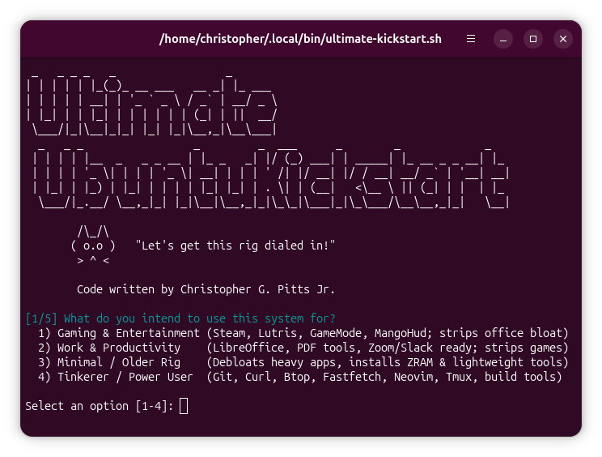

# Ultimate-Ubuntu-Kickstarter
Interactive post-install configurator, debloater, and app installer for fresh Ubuntu systems.
# Ultimate Ubuntu Kickstart

An interactive post-install configurator, debloater, and app installer for fresh Ubuntu 26.04+ installations—complete with a custom ASCII mascot. Apart of the Ultimate Ubuntu Suite!



## Features
- **Tailored System Profiles:** Configure your rig for **Gaming & Entertainment**, **Work & Productivity**, **Minimal / Older Hardware**, or **Tinkerer / Power User** workflows.
- **Smart Debloating:** Safely removes unused default APT and Snap apps based on your chosen profile.
- **Privacy Hardening:** Choose between **Standard**, **Balanced** (disables telemetry/apport + enables UFW firewall), or **Strict** (disables connectivity checks + configures DNS-over-TLS).
- **Browser Choice:** Easily install **Brave**, replace Snap Firefox with **Mozilla's native `.deb`**, or install **LibreWolf** via Flatpak.
- **Companion Tool Integration:** Optionally installs [Ultimate Ubuntu Updater](https://github.com/kintaris3/Ultimate-Ubuntu-Updater) automatically at the end of setup.

## Installation & Quick Start

### Option 1: Instant Run on a Fresh Install (No Download Needed)
Run directly in your terminal right after installing Ubuntu:
```bash
bash <(wget -qO- [https://raw.githubusercontent.com/kintaris3/Ultimate-Ubuntu-Kickstart/main/ultimate-kickstart.sh](https://raw.githubusercontent.com/kintaris3/Ultimate-Ubuntu-Kickstart/main/ultimate-kickstart.sh))
```

### Option 2: Install as a Desktop App (`.deb`)
```bash
wget [https://github.com/kintaris3/Ultimate-Ubuntu-Kickstart/releases/download/v1.0/UUK_v1.0.zip](https://github.com/kintaris3/Ultimate-Ubuntu-Kickstart/releases/download/v1.0/UUK_v1.0.zip) && unzip UUK_v1.0.zip && sudo apt install ./UUK_v1.0/ultimate-ubuntu-kickstart_1.0_all.deb
```

### Option 3: Manual Download
1. Download `UUK_v1.0.zip` from the [Releases](https://github.com/kintaris3/Ultimate-Ubuntu-Kickstart/releases) page.
2. Right-click `UUK_v1.0.zip` and select **Extract Here**.
3. Open the `UUK_v1.0` folder and double-click `ultimate-ubuntu-kickstart_1.0_all.deb` to install via App Center, or run `sudo apt install ./UUK_v1.0/ultimate-ubuntu-kickstart_1.0_all.deb`.
4. Press the **Super** key and launch **Ultimate Ubuntu Kickstart**.
